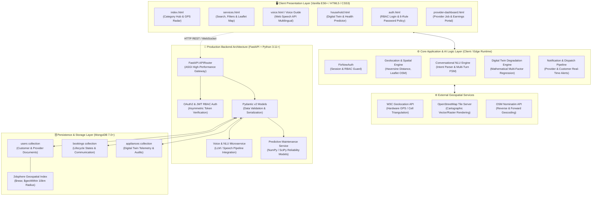
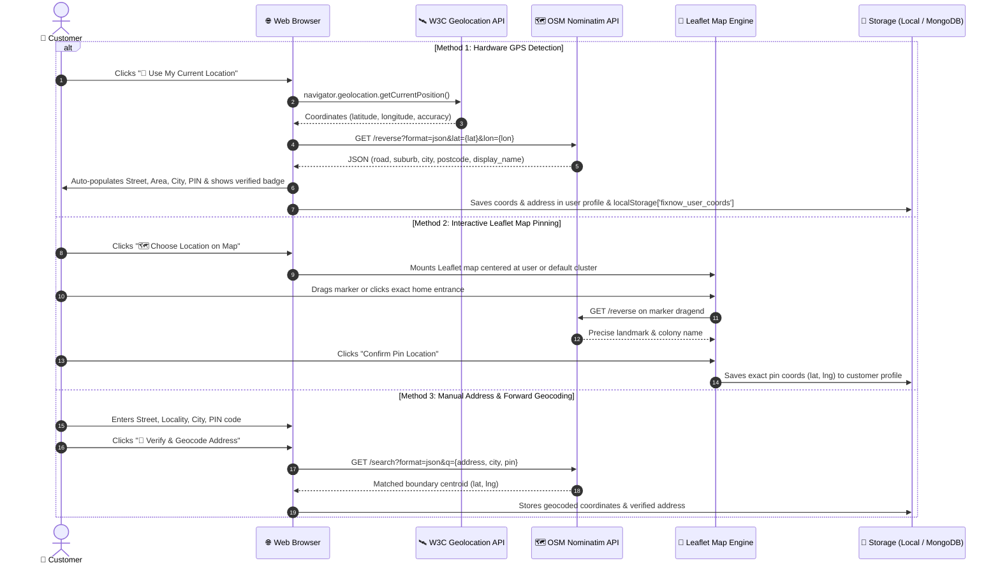
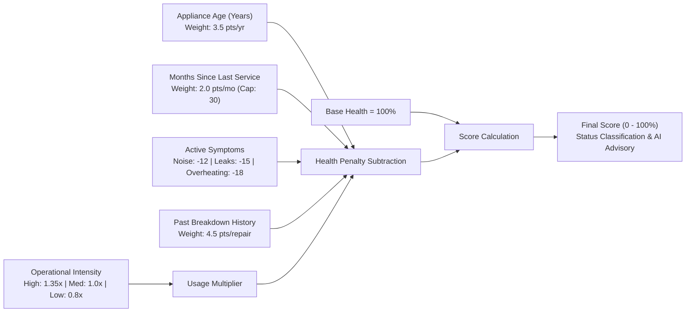

# FixNow System Architecture Specification
**Production-Grade Architectural Blueprint for AI-Powered Local Service Ecosystem**

---

## 1. Executive Summary & Architectural Vision

**FixNow** is an AI-powered, geolocation-aware hyper-local service dispatch platform designed to connect household customers with verified local technicians (plumbers, electricians, beauticians, mechanics, HVAC specialists, carpenters, painters). It is uniquely engineered to serve both semi-urban and rural clusters by overcoming two critical real-world hurdles:
1. **Low-literacy and regional language barriers** through a native, zero-dependency multilingual AI voice assistant operating in English, Telugu, and Tamil.
2. **Preventive maintenance neglect** through an explainable **Household Digital Twin Engine** that continuously predicts appliance health degradation, schedules timely service, and reduces costly emergency breakdowns.

FixNow operates under a clean, decoupled architecture ready to transition from a resilient client-side progressive web application to a high-concurrency **FastAPI + MongoDB** enterprise backend.

---

## 2. Comprehensive System Architecture Diagram



---

## 3. Component Layer Breakdown

### 3.1. Client Presentation Layer
- **Zero-Dependency Vanilla JavaScript (ES6+)**: Developed without heavy framework abstractions (React/Angular/Vue) to ensure sub-second initial load times even over 2G/3G rural network connections.
- **Progressive Enhancement**: All core features (login, service discovery, appliance tracking) function cleanly with standard semantic HTML5 and CSS3 custom properties (design tokens).
- **Web Speech API**: Uses native `webkitSpeechRecognition` / `SpeechRecognition` for acoustic input and `speechSynthesis` for text-to-speech audio feedback across English (`en-IN`), Telugu (`te-IN`), and Tamil (`ta-IN`).

### 3.2. Core Application & AI Logic Layer
1. **Single Source of Truth (`mockData.js` / API Data Bridge)**:
   - Contains zero hardcoded fake technicians, fake ratings, or dummy reviews.
   - Merges verified registered providers dynamically from persistent storage (`localStorage['fixnow_users']` or MongoDB API).
2. **Conversational NLU & Multi-Turn State Machine (`voice.js`)**:
   - Analyzes natural speech tokens using category tokenization, phonetic matching, and slot extraction.
   - Maintains conversational context across a finite state machine:
     `IDLE` $\rightarrow$ `AWAITING_PROVIDER_SELECTION` $\rightarrow$ `AWAITING_DATETIME` $\rightarrow$ `CONFIRMING` $\rightarrow$ `DISPATCHED`.
3. **Multi-Factor Digital Twin Degradation Engine (`household.js`)**:
   - Calculates dynamic health scores ($0-100\%$) and failure risks for appliances using multi-variable regression instead of hardcoded numbers.
4. **Real-Time Notification & Booking Dispatch Pipeline (`main.js` & `notifications.js`)**:
   - Automatically generates unique tracking codes (`#FN-XXXXXX`).
   - Dispatches simultaneous events to both the selected technician and the booking customer.

---

## 4. Realistic Customer Location Architecture

A critical technical feature of FixNow is how a customer realistically supplies their location without fake hardcoded coordinates.

### 4.1. Three-Tiered Location Acquisition Sequence



### 4.2. Mathematical Proximity Calculation (Haversine Formula)

Once the customer's coordinates $(\phi_1, \lambda_1)$ are established, the system dynamically calculates the great-circle distance $d$ in kilometers to each registered provider $(\phi_2, \lambda_2)$:

$$\Delta\phi = (\phi_2 - \phi_1) \cdot \frac{\pi}{180}, \quad \Delta\lambda = (\lambda_2 - \lambda_1) \cdot \frac{\pi}{180}$$

$$a = \sin^2\left(\frac{\Delta\phi}{2}\right) + \cos\left(\phi_1 \cdot \frac{\pi}{180}\right) \cdot \cos\left(\phi_2 \cdot \frac{\pi}{180}\right) \cdot \sin^2\left(\frac{\Delta\lambda}{2}\right)$$

$$c = 2 \cdot \text{atan2}\left(\sqrt{a}, \sqrt{1 - a}\right)$$

$$d = R \cdot c \quad (\text{where Earth radius } R = 6371.0 \text{ km})$$

**Spatial Filtering Rule:**
A technician $P$ is visible to customer $C$ if and only if:
$$d(C, P) \le \text{ProviderOperatingRadius}_P \quad \text{AND} \quad d(C, P) \le \text{CustomerFilterRadius}_C$$

---

## 5. Security & Access Control Architecture

### 5.1. Strict Password Policy Enforcement

To ensure enterprise-grade security, both Customer and Service Provider signups enforce a 6-condition entropy policy:

| Rule # | Requirement | Validation Implementation |
|---|---|---|
| **1** | Minimum 8 characters | `password.length >= 8` |
| **2** | At least 1 Uppercase letter | `/[A-Z]/.test(password)` |
| **3** | At least 1 Lowercase letter | `/[a-z]/.test(password)` |
| **4** | At least 1 Number | `/[0-9]/.test(password)` |
| **5** | At least 1 Special character | `/[!@#$%^&*()_+\-=\[\]{};':"\\|,.<>\/?~`]/.test(password)` |
| **6** | Passwords match | `password === confirmPassword && password.length > 0` |

- **Live Dynamic UI Checklist**: As the user types into either the password or confirm password field, an interactive checklist dynamically toggles between `⚪` and `✅` with real-time feedback.
- **Backend Validation Hook**: In FastAPI, this policy is enforced via a Pydantic `field_validator('password')` with regex assertions before password hashing (`bcrypt`).

### 5.2. Role-Based Access Control (RBAC)
- **Role Isolation**: User profiles are partitioned into `customer` and `provider`.
- **Route Guarding**: Protected pages (such as `provider-dashboard.html`) enforce `window.FixNowAuth.requireProviderAuth()`. If an unauthenticated user or customer navigates there, an authentication overlay blocks access with a redirect to login.
- **Voice Assistant Boundary Guard**: A customer asking the voice assistant to accept bookings is blocked with an explicit security notice: *"This action is restricted to verified service providers. You are currently browsing in customer mode."*

---

## 6. Household Digital Twin Degradation Architecture

Instead of static dummy numbers, FixNow implements an **Explainable Multi-Factor Reliability Regression Model**:



### 6.1. Health Score Formula

$$\text{AgePenalty} = \text{AgeYears} \times 3.5$$

$$\text{ServicePenalty} = \min\left(30, \text{MonthsSinceService} \times 2.0\right)$$

$$\text{SymptomPenalty} = \sum \text{Deduction}(\text{Symptom}_i)$$

$$\text{HistoryPenalty} = \min\left(20, \text{PastRepairsCount} \times 4.5\right)$$

$$\text{TotalDeduction} = \left(\text{AgePenalty} + \text{ServicePenalty} + \text{SymptomPenalty} + \text{HistoryPenalty}\right) \times \text{UsageMultiplier}$$

$$\text{HealthScore} = \text{clamp}\left(100 - \text{TotalDeduction}, 15, 98\right)$$

---

## 7. Production FastAPI + MongoDB Mapping

When deploying to a full-stack containerized infrastructure, FixNow maps cleanly to the following architecture:

- **Web Server**: Uvicorn running FastAPI ASGI application with async worker processes.
- **API Endpoints**:
  - `POST /api/v1/auth/register` — User signup with bcrypt password hashing.
  - `POST /api/v1/auth/token` — OAuth2 Password Flow returning JWT bearer tokens.
  - `GET /api/v1/providers/nearby` — MongoDB `$near` geospatial query over `2dsphere` index.
  - `POST /api/v1/bookings/dispatch` — Transactional booking dispatch with WebSocket events.
  - `POST /api/v1/household/twin` — Appliance telemetry logging & predictive maintenance calculation.
- **Database Indexing**:
  ```javascript
  db.users.createIndex({ "coordinates": "2dsphere" })
  db.bookings.createIndex({ "customerId": 1, "status": 1 })
  db.bookings.createIndex({ "providerId": 1, "status": 1 })
  ```
